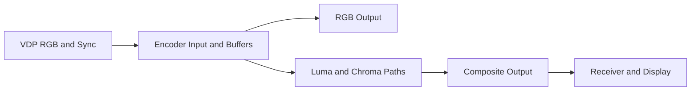

# CXA1145 Video Encoder Research

**Research checkpoint — 27 October 2026 (Sydney).** This report predates the
subsequently authorized [RGB input approximation](RGB-ENCODER-INPUTS.md). Its
proposed experiments below are research gates, not completed physical tests.
The user requested this investigation while reviewing the Z80 RAM build.
Existing application behaviour, versions, releases and McRetro.net are unchanged.

## Finding

Yes: the CXA1145P is a useful candidate for a separate output-stage experiment.
It accepts analogue RGB and composite sync, buffers RGB, and encodes composite
video. A fault here can change the displayed picture without deliberately
changing CPU execution, VRAM or Work RAM. A receiver can lose the picture while
the game continues running. This does not repair a game already stopped by a
memory fault, and is not a claim that physical shorts cannot disturb the board.

The receiver matters: loss of colour, rolling, tearing, blanking or a no-signal
screen depends on its colour and sync recovery. They are plausible outcomes,
not universal pin-to-effect promises.

## Sources and Device Boundaries

1. Sony, [CXA1145P/M manufacturer scan](https://consolemods.org/wiki/images/3/3d/CXA1145.pdf):
   PDF pages 1–6 cover features, block diagram and pin descriptions; page 10
   covers burst timing. P is DIP-24; M is SOP-24. The following table refers
   to this family, not every replacement encoder.
2. Sony, [CXA1645P/M, E93411A41-ST](https://www.100y.com.tw/pdf_file/CXA1645P.M.pdf):
   PDF pages 1–5. It integrates the chroma filter and luma delay and has driven
   Y/C outputs. Pin 8 is BFOUT, a burst-flag monitor; pin 9 is YCLPC, setting
   the Y-clamp time constant. Pin 11 is NC;
   pins 17/18 become YTRAP/FO. It is not a CXA1145 pin-function substitute.
3. Sega, [Genesis II / Mega Drive II service manual No. 001, June 1993](https://www.backoldgaming.com/data/medias/files/documents/Sega_Service_Manual_-_Genesis_II_-_Mega_Drive_II_PAL_-_001_-_June_1993.pdf#page=2):
   PDF page 2 identifies F = MB3514PF, S = CXA1145M and SM = KA2195D and
   explicitly requires the matching circuit differences. These are Model 2
   alternatives, not proof of an NTSC Model 1 VA6 installation or interchangeability.
4. Sega, [PAL-G Model 1 manual, August 1992](https://consolemods.org/wiki/images/6/6b/PAL_Mega_Drive_Model_1_Service_Manual.pdf#page=5):
   block diagram at PDF page 5; CXA1145 specification at PDF pages 61–63.
   This establishes an analogue output-stage reference, not the unresolved
   NTSC VA6 board map in [#73](https://github.com/NixMcRetro/VRAMpage-MD/issues/73).
5. Greg Ewing, [PAL colour encoding and receiver phase reference](https://www.csse.canterbury.ac.nz/greg.ewing/c64_pal_decoder/PAL/PAL-Video-Encoding.html).
   This explains the receiver principle; it does not establish a Mega Drive fault trace.

Manufacturer text/pin tables and the pinned source were inspected. PDF screenshot
requests returned image markers through the research connector rather than
inspectable images; no independent visual verification of those scans is claimed.
No board, waveform or listening measurement was performed. A Fujitsu pin-level
model still needs its own complete manufacturer sheet and matching circuit.

The [28 October service-manual follow-up](SEGA-MANUAL-EVIDENCE.md) adds visual
inspection of the supplied PAL-G Part 2 p. 18 CXA1145P/M block/pin diagram and
Model 2 Version 1 supplement p. 4 encoder-variant table. This supports the
separate RGB/composite/sync/audio branches and variant distinctions above;
it adds no analogue fault measurements or new composite/receiver model.

## Signals Worth Investigating

Sony pin facts below come from source 1. The last column is a hypothesis requiring
an explicit source/termination model and, for composite effects, a receiver model.
These are signal references, not physical wiring instructions.

| CXA1145 Signal | Pin(s) | Candidate Effect and Limitation |
| --- | --- | --- |
| R/G/B In | 2/3/4 | Channel attenuation or coupled colours. A join is analogue loading, not a low-dominant digital bit bridge. |
| Oscillator / Subcarrier | 5/6 | Unstable or lost composite colour. Actual behaviour depends on oscillator wiring and decoder lock. |
| NTSC/PAL In | 7 | Encoder colour-mode mismatch. This does not switch the VDP region, master clock or game frame rate. |
| Audio In/Out | 8/9 | Mono-buffer output attenuation or loss where routed through this buffer; FM/PSG registers remain separate. |
| Composite Sync In/Out | 10/11 | Lost timing, blanking or receiver-dependent instability. Input sync also controls encoder pulses/clamping. |
| Chroma Out/In | 15/17 | Disturb the external filter path; composite colour changes while the RGB branch is separate. |
| Luma Out/In | 16/18 | Disturb the external delay path; composite brightness/detail/timing changes. |
| Composite Out | 20 | Output interruption/loading affects the selected composite connection. |
| B/G/R Out | 21/22/23 | RGB-output channel faults; not the same branch as the encoder's RGB inputs. |

The CXA1145 Y/C pins are external processing loops, not a promise of directly
usable S-video. Power, grounds and internal references are excluded from an
initial virtual contact set; their failure needs a different electrical model.

Two traps matter. An open analogue input is not automatically zero: its result
depends on coupling, bias, clamps and source impedance. Also, shifting burst and
picture chroma together does not necessarily rotate decoded hue because the
receiver uses burst as its phase reference. A CSS hue rotation is not evidence
of a subcarrier fault. Shared supply or source loading can also couple physical
faults into other circuitry; the proposed output-only isolation is a software boundary.

## What the Browser Currently Has

Inspected app: [`1b464a9`](https://github.com/NixMcRetro/VRAMpage-MD/tree/1b464a90daa1b8ba8d9ff321475ccb4dc8ff865c).
The pinned core remains
[`h1romas4/wasm-genplus` at `6090aff`](https://github.com/h1romas4/wasm-genplus/tree/6090aff9e9b2f578cd28882bd4571d2e35b1d674).

- [`CMakeLists.txt`](https://github.com/h1romas4/wasm-genplus/blob/6090aff9e9b2f578cd28882bd4571d2e35b1d674/CMakeLists.txt#L80)
  selects 32-bit rendering. [`config.c`](https://github.com/h1romas4/wasm-genplus/blob/6090aff9e9b2f578cd28882bd4571d2e35b1d674/src/main/c/wasm/config.c#L37)
  disables the NTSC filter; the optional filter branch in
  [`remap_line`](https://github.com/h1romas4/wasm-genplus/blob/6090aff9e9b2f578cd28882bd4571d2e35b1d674/src/main/c/core/vdp_render.c#L4194)
  is compiled only for 15/16-bit output. Its presence is not an existing CXA model.
- The project's [source patch](https://github.com/NixMcRetro/VRAMpage-MD/blob/1b464a90daa1b8ba8d9ff321475ccb4dc8ff865c/scripts/patch_core.py)
  produces RGBA pixels; [`drawActiveVideo`](https://github.com/NixMcRetro/VRAMpage-MD/blob/1b464a90daa1b8ba8d9ff321475ccb4dc8ff865c/site/app.js#L2871)
  copies the frame to a canvas. It does not export a sampled composite waveform,
  colour burst, encoder voltages or a TV decoder state.

Intentional output damage should follow the existing missing-row recovery, or
explicitly bypass it, so legacy display repair cannot erase the intended fault.
Keep the untouched core frame available as a diagnostic reference.

A browser implementation therefore needs an explicit output-domain model. A
small transformation can approximate selected RGB input faults; modelling
subcarrier/sync behaviour needs additional timing and decoder assumptions.
That output processing is appropriate for an encoder experiment, but must not
be presented as evidence of RAM corruption or altered sound-chip writes.

## Smallest Candidate and Acceptance Before Implementation

Recommend investigating **RGB input contacts first**, off by default and clearly
labelled as an approximation. Define the mapping from core RGB codes to a voltage
proxy, an explicit termination for a cut, and source/bridge impedances for a join.
Do not silently average gamma-coded pixels or reuse the RAM bitwise rule.
Leave composite sync/subcarrier and the separate mono buffer for later bounded
models. This is a recommendation, not implementation or release authorization.

Future acceptance should establish:

- Disabled identity: exact existing pixels, PCM, CPU/RAM state and exports.
- Literal colour-bar/grey-ramp oracles for individual channels and each of the
  three RGB pairs. Under an explicitly equal-impedance, zero-resistance join,
  voltage inputs (1,0,0) with R/G joined become (0.5,0.5,0); test that stated
  circuit assumption before display conversion, not an invented analogue trace.
- Route isolation: composite-only faults do not alter RGB output; RGB-input
  faults feed both branches. RGB-output contacts affect only their branch.
- Repeated apply/remove, deterministic state/export, checkpoint/restart policy,
  no fault-driven CPU recovery, and unchanged emulation with the output model off.
- A measured performance budget and Chromium/Firefox/WebKit coverage. Any later
  composite model needs original waveform fixtures with known burst/sync and
  named decoder behaviour, including colour-loss and reacquisition limits.

The original free colour-test ROM is a suitable picture fixture. It is silent
and does not validate the mono audio path. Existing automated checks validate
the current app only; none of these proposed encoder-model tests has been run.
